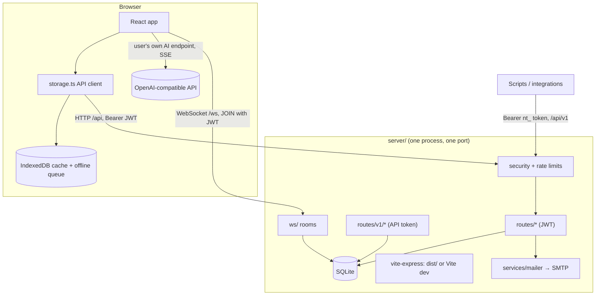

# 📁 Project Structure

A map of the codebase for new contributors and AI assistants: where things live and how data flows. Paths are relative to the repository root.

## 🌳 Directory tree

```text
netherite-notes/
├── server/                        # Backend (Node.js, Express 5, SQLite, ws)
│   ├── index.js                   # Process entry: config → DB + migrations → HTTP + WebSocket → static/Vite
│   ├── app.js                     # createApp(): middleware order and route registration
│   ├── config.js                  # All environment parsing; NODE_ENV defaults to production; secret checks
│   ├── db/
│   │   ├── index.js               # Process-wide handle: { run, get, all, transaction }
│   │   ├── connection.js          # sqlite3 wrapper; WAL + foreign keys; serialized transactions
│   │   ├── migrate.js             # Migration runner (+ automatic pre-migration backup)
│   │   └── migrations/            # 001_baseline … 007_join_codes — additive, idempotent, one transaction each
│   ├── lib/
│   │   ├── http.js                # HttpError, error responses (v1 vs core shape), async handler wrapper, error handler
│   │   ├── validate.js            # Username/password/email/note validation, HTML/LIKE escaping
│   │   ├── accounts.js            # JWT sign/verify, authenticateJWT, requireAdmin, authResponse
│   │   ├── membership.js          # Vault membership checks, createVault, share codes, note quota
│   │   ├── secret-box.js          # AES-256-GCM for stored AI keys; sha256 helper for token hashes
│   │   ├── audit.js               # Append-only audit log helper + pruning
│   │   └── ids.js                 # CSPRNG ids, uuid
│   ├── middleware/
│   │   ├── security.js            # Request id, helmet (CSP, HSTS…), PWA headers, CORS allow-list
│   │   ├── rate-limits.js         # All rate limiters
│   │   └── api-token.js           # API-token auth, permission checks, vault scope, token-owner check
│   ├── routes/
│   │   ├── health.js              # GET /api/v1/health, /healthz
│   │   ├── auth.js                # register, login, verify-email, forgot/reset password, /api/auth/config
│   │   ├── users.js               # profile, settings, AI config
│   │   ├── admin.js               # users, audit log, invite codes
│   │   ├── vaults.js              # vaults (groups), sharing, join/leave, export/import
│   │   ├── notes.js               # notes used by the web app
│   │   └── v1/                    # tokens.js vaults.js notes.js links.js bulk.js — REST API for integrations
│   ├── services/
│   │   ├── mailer.js              # SMTP transport + reset/verification email templates
│   │   └── verification.js        # issue + send an email-verification token
│   └── ws/index.js                # WebSocket: authenticated rooms, presence, change relay
├── src/                           # Frontend (React 18, TypeScript, Tailwind 3, Vite 7)
│   ├── main.tsx                   # Mount point, error boundary, service-worker registration
│   ├── App.tsx                    # Root: session, vaults, notes, WebSocket, layout, command palette wiring
│   ├── index.css                  # Tailwind entry + app shell styles
│   ├── constants.ts  types.ts
│   ├── lib/urlTokens.ts          # Reads one-time #reset / #verify tokens and clears them from the URL
│   ├── components/
│   │   ├── MarkdownEditor.tsx     # Block-based live-preview editor, raw mode, [[wikilink]] autocomplete
│   │   ├── GraphView.tsx          # D3 force-directed link graph
│   │   ├── AIPane.tsx             # AI assistant panel (browser → user's endpoint, SSE, <think>, Apply/Undo)
│   │   ├── CommandPalette.tsx     # Ctrl/Cmd+K palette
│   │   ├── auth/AuthScreen.tsx    # Login, register (open/invite/closed), forgot, reset
│   │   └── modals/                # SimpleModal, AccountSettings, VaultSettings (sharing, backup, tokens),
│   │                              #   TokenManagement, AdminPanel (+ AdminActivity: invites and audit log)
│   └── services/
│       ├── storage.ts             # API client, session/JWT storage, offline queue, local-data purge
│       └── localDb.ts             # Dexie (IndexedDB) schema: notes, groups, syncQueue
├── public/                        # Static assets copied to dist/: manifest + 192/512 px icons
├── scripts/
│   ├── build-sw.js                # Workbox service worker (runs after vite build)
│   ├── db-backup.js               # Online SQLite backup (npm run db:backup)
│   ├── admin-create.js            # Create/prepare an admin account from the shell (npm run admin:create)
│   ├── doctor.js                  # Read-only config + database health report (npm run doctor)
│   └── smoke-test.js              # Health check; with --full, REST v1 checks using your token (npm run health / smoke)
├── tests/                         # node:test suites — boot real servers on temp databases
│   ├── helpers/harness.js         #   server spawner, fake SMTP sink, HTTP/WebSocket helpers
│   ├── api-v1.test.js             #   REST v1 + web-client contract (must stay green through refactors)
│   ├── security.test.js           #   regression tests for every audit finding
│   └── hardening.test.js          #   verification, AI-key encryption, share codes, upgrade-from-1.0.0, quotas, CSP…
├── deploy/                        # Dockerfile companions: docker-compose.yml, systemd unit, Caddy + nginx examples
├── docs/                          # API_REFERENCE.md  PROJECT_STRUCTURE.md  Context.md  UPGRADING.md  DEPLOYMENT.md
├── .github/                       # CI workflow (lint, typecheck, build, test, audit, secret scan) + Dependabot
├── server.js                      # One-line shim → server/index.js (keeps `node server.js` working)
├── index.html                     # Vite entry (no inline scripts or styles)
├── vite.config.js  tailwind.config.js  postcss.config.js  tsconfig.json  eslint.config.js
├── package.json  package-lock.json  .nvmrc  Dockerfile  .dockerignore  .env.example  .gitignore
└── README.md  SECURITY.md
```

Generated or local only (git-ignored): `node_modules/`, `dist/`, `.env`, `*.db` (and `-wal`/`-shm`), `backups/`.

## 🚀 Scripts

| Command | What it does |
|---|---|
| `npm run dev` | Development: `NODE_ENV=development node server.js` — Express + Vite middleware with hot reload on `127.0.0.1:20100`. **Never expose this publicly.** |
| `npm run build` | `vite build` → `dist/` (client + compiled Tailwind), then the service worker |
| `npm start` | Production: `NODE_ENV=production node server.js` (serves `dist/` and the API on one port) |
| `npm test` | All suites (`node --test`) |
| `npm run lint` / `typecheck` | ESLint for server/scripts/tests; `tsc --noEmit` for `src/` |
| `npm run health` / `smoke` | Health check / full REST v1 check against a running server |
| `npm run db:backup` | Consistent online backup to `backups/` |
| `npm run admin:create -- --email … --username …` | Create/prepare an admin account |
| `npm run doctor` | Read-only configuration and database report |

## 🧩 How requests flow



**Middleware order** (`server/app.js`): security headers + request id → health → API rate limits → JSON body (1 MB; import route has its own authenticated 25 MB parser) → routes → JSON 404 for unknown `/api/*` → static client/Vite → final error handler.

**Authorization model:** JWT routes resolve the caller from the *database* (not the token) on every request; vault routes require membership (owner for management); API-token routes are scoped to one vault and one permission set; admin routes need an ADMIN_EMAILS address that is verified.

## 🗄️ Database schema (`obsidian.db`)

SQLite, WAL mode, foreign keys on. Managed by `server/db/migrations/` (table `schema_migrations`). Migrations are additive and idempotent; before the first pending migration on an existing database a copy is written to `backups/pre-migrate-v<N>-<timestamp>.db`.

### `users`
| Column | Notes |
|---|---|
| `id` TEXT PK | UUID |
| `username` TEXT UNIQUE | plus a unique NOCASE index (when no legacy collisions exist) |
| `password` TEXT | bcrypt hash (12 rounds) |
| `email` TEXT | lower-case |
| `email_verified` INTEGER | 0/1; admin rights require 1 |
| `verify_token_hash`, `verify_expires` | SHA-256 of the emailed verification token, 24 h |
| `reset_token_hash`, `reset_expires` | SHA-256 of the emailed reset token, 1 h. (`reset_token` is a legacy, always-NULL column.) |
| `token_version` INTEGER | bumping it signs out every session of that user |
| `ai_endpoint`, `ai_model` | BYOC AI settings |
| `ai_api_key_enc` | `v1:iv:tag:ciphertext` AES-256-GCM. (`ai_api_key` is a legacy, always-NULL column.) |
| `keybind_split_block`, `keybind_new_line` | editor keybindings |

### `groups` (vaults)
`id` (PK, 12 chars; older vaults 7), `name`, `ownerId`, `join_code` (UNIQUE; older vaults: equals `id`), `join_enabled` (0/1).

### `user_groups`
Membership: `userId`, `groupId` (composite PK; indexed both ways).

### `notes`
`id` PK (UUID or client-chosen), `groupId`, `title`, `content`, `createdAt`, `updatedAt`, `isBookmarked`. Indexed on `(groupId, updatedAt)`.

### `api_tokens`
`id`, `group_id` (FK → groups, `ON DELETE CASCADE`), `token_hash` (UNIQUE; HMAC-SHA256), `token_prefix`, `name`, `permissions` (JSON array), `created_at`, `last_used_at`, `expires_at`, `is_active`.

### `audit_log`
`id`, `ts`, `actor_id`, `action`, `target`, `ip`, `detail` (JSON, no secrets). Pruned after `AUDIT_RETENTION_DAYS`.

### `invites`
`id`, `code_hash` (UNIQUE), `code_prefix`, `created_by`, `created_at`, `expires_at`, `used_by`, `used_at`.

### `schema_migrations`
`version`, `name`, `applied_at`.

## 🖥️ Client data layer

`src/services/storage.ts` is the only code that talks to the server. Reads fall back to IndexedDB (Dexie) when offline; writes go to IndexedDB first, then the server, and are queued in `syncQueue` if the call fails — the queue replays in order when the browser comes back online. `purgeLocalData()` (logout, expired session) clears the session, the cached notes/vaults and the queue. A 401 on any authenticated request triggers the app-wide "session ended" handler.

## ➕ Adding things

- **A route:** create or extend a file in `server/routes/`, export `function register(app)`, add it to `server/app.js`, add tests, document it in `docs/API_REFERENCE.md`.
- **A schema change:** add `server/db/migrations/00N_name.js` (`{ version, name, async up(tx, ctx) }`), list it in `migrations/index.js`. Keep it additive; use `ctx.addColumnIfMissing`. Test the upgrade path with a legacy database (see `tests/hardening.test.js`).
- **A secret or setting:** read it in `server/config.js` only, document it in `.env.example` and the API reference.
